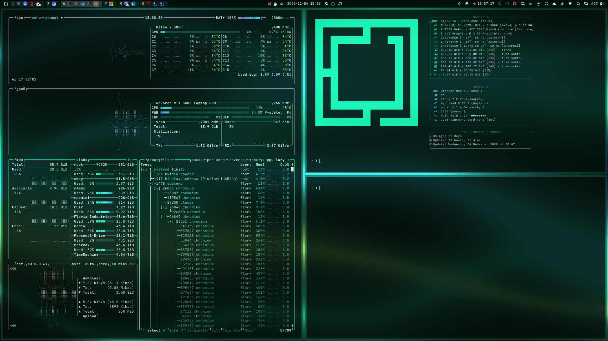

# Acid Rain Green



A green-first variant of Acid Rain, centred on `#1bf6b4`.
Mint neon, cyan and lime sit over deep teal-black, with mint-white text.
Pink is reserved for a muted semantic terminal colour.

The original Acid Rain theme is kept separately and unchanged.

Install and apply:

```bash
git clone https://github.com/xadacka/omarchy-acid-rain-green-theme ~/.config/omarchy/themes/acid-rain-green
```

```bash
omarchy theme set acid-rain-green
```

Return to the original:

```bash
omarchy theme set acid-rain
```

The eight original wallpaper compositions are regenerated with mint as the
primary colour, supported by cyan and lime. The diagonal border, keyboard
colour and sage icons follow the palette.

Regenerate all eight wallpapers (Python, NumPy and Pillow required):

```bash
python3 tools/gen_backgrounds.py backgrounds 3840 2160
```

Original theme and wallpaper generator: Acid Rain. See LICENSE.
